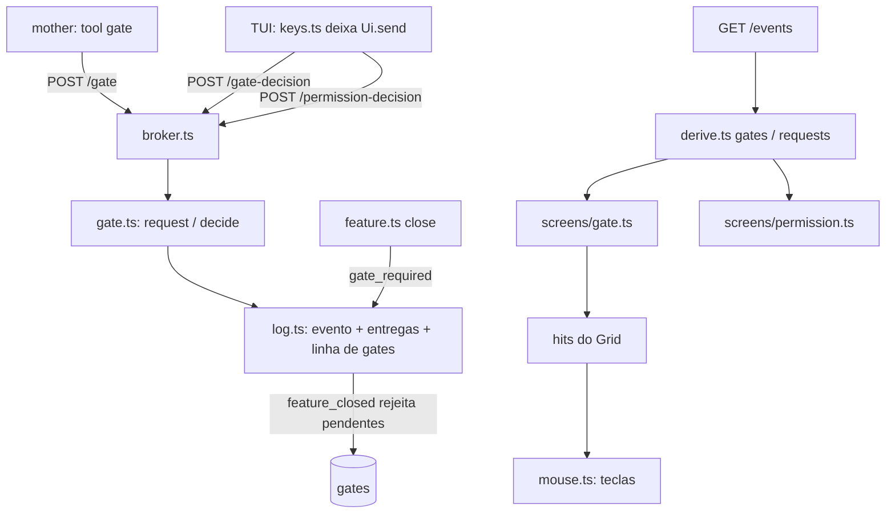

# Gate Design

**Spec**: `.specs/features/gate/spec.md`
**Status**: Approved (pelo orquestrador; os defaults `n` da spec ficam para o dev revisar no PR)

---

## Architecture Overview

A fatia segue os moldes que a Question deixou: uma rota com credencial de peer e outra com a
credencial humana, uma tabela que é a projeção do log gravada na mesma transação do evento, e
a derivação que reconstrói a tabela só dos eventos. Na TUI, cada modal novo é um estado em
`Ui`, um redutor de teclas puro em `tui/keys.ts`, um envio deixado em `Ui.send` para o laço
(AD-014), e uma tela portada do protótipo (`gateModal`, `permModal`) que marca no `Grid` o
que o mouse acerta (AD-021).



---

## Code Reuse Analysis

### Existing Components to Leverage

| Component | Location | How to Use |
| --------- | -------- | ---------- |
| `createQuestion` | `broker/question.ts` | Molde de `createGate`: `no()` grava `refused`, `log.transaction`, `answerAsHuman` para a rota humana |
| `log.record`, `log.refused`, `log.transaction`, `log.close` | `broker/log.ts` | Gravar `gate` e `gate_decision`; `close` ganha o `UPDATE gates` como já tem o de `questions` |
| `appendEvent` com `gate_id` | `broker/db.ts` | Já aceita `gate_id`; falta `NewRecord.gate_id` em `log.ts` repassá-lo |
| `history({ gate_id })` | `broker/log.ts` | Já lê os eventos de um gate: versões e comentários |
| `permission.decision` | `broker/permission.ts` | A rota que o modal de permissão chama, sem mudança |
| `gates()`, `openPermissions()` | `broker/shared/derive.ts` | Estendidas; `squad()` continua dando `gates` e `permissions` |
| `toolsFor`, `ROUTE_OF`, `allowed` | `broker/tools.ts`, `broker/launch.ts` | A tool `gate` entra em `OF_ROLE.mother`; `allowed` a deriva sozinha |
| `answering`, `settle`, `sync`, `input` | `broker/tui/keys.ts` | Mesmo formato para `gating` e `permitting`; `input` ganha a regra da colagem dos modais novos |
| `drawModal`, `drawInput` | `broker/tui/screens/answer.ts` | Saem para `screens/modal.ts` com `x`, `w`, cor da borda e etiqueta, como o `drawModal` do protótipo |
| `drawKeys`, `statusSegs`, `stats` (custo) | `broker/tui/screens/chrome.ts` | Rodapé clicável dos modais; status `[blocked x]`; o custo da feature vira função `featureCost(view)` |
| `createWriter` | `broker/tui/writer.ts` | Um `post(path, body)` interno com o mesmo prazo e o mesmo erro; `answer`, `gate` e `permission` em cima dele |
| `point`, `answered`, `walk` | `broker/tui/mouse.ts` | `answered` passa a tratar os três modais; a fila usa `walk` com `[` e `]` |
| `LOGS`, `DEVIATIONS`, `frameView`, `extract.ts` | `broker/test/frames/` | Os 13 frames novos entram do mesmo jeito; `G01`, `COMMENT`, `G02` já existem |
| `test/terminal.ts`, `cli.test.ts` | `broker/test/` | O laço e o caso de ponta a ponta num pseudo-terminal |

### Integration Points

| System | Integration Method |
| ------ | ------------------ |
| Broker HTTP | `/gate` em `PEER_ROUTES` (credencial de peer), `/gate-decision` ao lado de `/permission-decision` (credencial humana) em `broker.ts` |
| SQLite | Tabela `gates` criada em `openDatabase`; `events.gate_id` já referencia `gates(id)` |
| MCP | Tool `gate` só da mother; o push do `gate_decision` é o de qualquer evento (`toPush`) |
| Plugin | Duas seções da skill da mother reescritas; `skills.test.ts` troca os testes de PAP-72 |
| TUI | `Ui.gate`, `Ui.permission`, `Ui.send` como união; `tui.ts` desenha o modal sobre a tela principal |

---

## Components

### `broker/gate.ts` (novo)

- **Purpose**: `/gate` e `/gate-decision`: a vida de um gate na tabela `gates`.
- **Interfaces**:
  - `createGate(db, log, token)` → `{ request(peer, body), decide(body), approved(): boolean }`
  - `request`: valida na ordem de GAT-07; cria (GAT-01, GAT-02) ou reemite (GAT-12); `refused` com `attempted_kind` `gate`.
  - `decide`: valida na ordem de GAT-25; numa transação relê a linha (`pending`?), grava o `gate_decision` com `recipients: [requested_by]` e atualiza a linha (GAT-15 a GAT-17, GAT-24).
  - `approved()`: a feature aberta tem gate `delivery` `approved`; `feature.ts` a recebe por injeção.
- **Reuses**: `isText`, `SUMMARY_MAX` de `send.ts`; `refuse` de `peers.ts`; `tickets()` de `derive.ts` sobre `log.featureEvents()` para `tickets_open`.

### `broker/log.ts`, `broker/db.ts`, `broker/feature.ts`, `broker/send.ts`, `broker/broker.ts`

- `db.ts`: `CREATE TABLE gates` (colunas do design) e `GateRow`.
- `log.ts`: `NewRecord.gate_id` repassado a `appendEvent`; `close` rejeita os pendentes (GAT-28).
- `feature.ts`: `createFeature(log, approved)`; `close` responde `gate_required` depois de `invalid_field` (GAT-26, GAT-29).
- `send.ts`: `gate` e `gate_decision` em `ROUTE_OF` (GAT-11).
- `broker.ts`: as duas rotas; `/gate` entre as que exigem peer.

### `broker/shared/derive.ts`

- `Gate` ganha `requested_by`, `scope`, `commit`, `status`, `decision_seq`, `version`, `summary`, `body`, `action`, `effect`, `diffstat`, `previous` (o `diffstat` da versão anterior), `first_ts`, `ts`, `comment` (`{ text, ts } | null`) e `text`. `pending` fica (GAT-33). `gates(events)` lê o `feature_closed` (GAT-32).
- `Squad.requests`: todo `permission_request` do log, em ordem, com `label` (`P-NN`), `open`, `closedBy` (`"decision" | "peer" | null`) e `closedTs`. `openPermissions` continua a fonte de `open`.

### `broker/tui/view.ts`, `broker/tui/keys.ts`

```typescript
interface GateModal {
  id: number;
  mode: "view" | "confirm" | "reject" | "comment";
  text: string;
  expanded: boolean;
  // enter com o campo vazio (GAT-56)
  empty: boolean;
  sending: boolean;
  // a versão que estava na tela quando o modo de confirmação abriu (GAT-59)
  version: number;
}
interface PermissionModal {
  seq: number;
  offset: number;
  sending: boolean;
}
// Ui ganha gate e permission; send vira a união do que o laço envia
type Send =
  | { question_id: number; answer: string }
  | { gate_id: number; decision: "approve" | "reject" | "comment"; text?: string }
  | { request_seq: number; behavior: "allow" | "deny" };
```

- `press` despacha para `answering`, `gating` ou `permitting` pelo modal aberto; `g` e `x` abrem (GAT-40, GAT-60).
- `settle` decide pelo formato de `send`; `sync` fecha ou volta o modo (GAT-59, GAT-70).
- `input`: com o modal de gate em leitura ou confirmação, ou o de permissão aberto, `y`, `a`, `d`, `\r` e `\n` de um bloco colado são ignorados; num modo de texto o salto de linha vira espaço (GAT-75).
- O estado "respondido no terminal" não é campo: sai de `squad.requests` (`closedBy` `peer`).

### `broker/tui/screens/modal.ts` (novo), `gate.ts` (novo), `permission.ts` (novo), `answer.ts`, `help.ts`

- `modal.ts`: `drawModal(g, x, w, items, title, tone, border, tag?)` devolve a linha de cada item; `drawInput`; o item `pre` da prévia (`drawPre` do protótipo). `answer.ts` passa a usá-los sem mudar uma célula (frames 05, 06, 07, 20a, 20b).
- `gate.ts`: `gate(g, view)` porta `gateModal`; marca fora da caixa `esc`, a caixa inerte, e cada item da fila `{ modal, gate: id }`.
- `permission.ts`: `permission(g, view)` porta `permModal`; marca a fila `{ modal, request: seq }`.
- `help.ts`: as oito linhas do frame 11 (GAT-87).
- `tui.ts`: `screen()` desenha `main` e o modal por cima quando `ui.gate` ou `ui.permission` existe.

### `broker/tui/mouse.ts`, `broker/tui/grid.ts`, `broker/tui/screens/chrome.ts`

- `Hit` ganha `gate?: number` e `request?: number`.
- `point` usa "algum modal aberto" no lugar de `ui.modal !== null`; `answered` vira o despacho dos três modais: atalho → tecla; item da fila → `walk(pos, alvo, "[", "]")`.
- `SENT` ganha `a`, `r`, `c`, `y`, `d`, `G`, `]` e `[`.

### `broker/tools.ts`, `plugin/skills/mother/SKILL.md`

- `GATE_TOOL` com o esquema de GAT-34; `ROUTE_OF.gate = { path: "/gate" }`.
- A skill reescreve "Irreversible actions" e "Delivery" (GAT-37 a GAT-39).

---

## Data Models

### Tabela `gates`

```sql
CREATE TABLE IF NOT EXISTS gates (
  id INTEGER PRIMARY KEY,
  feature_id INTEGER NOT NULL REFERENCES features(id),
  requested_by TEXT NOT NULL,
  scope TEXT NOT NULL,
  "commit" TEXT,
  status TEXT NOT NULL,
  request_seq INTEGER NOT NULL REFERENCES events(seq),
  decision_seq INTEGER REFERENCES events(seq)
)
```

`commit` é palavra reservada do SQLite: vai entre aspas no `CREATE` e nas consultas. O id
vem de `MAX(id) + 1`, como `questions`; nenhuma linha é apagada.

---

## Error Handling Strategy

| Error Scenario | Handling | User Impact |
| -------------- | -------- | ----------- |
| Duas decisões finais ao mesmo tempo | A linha é relida dentro da transação do `gate_decision` (molde de `resolve`) | A segunda recebe `gate_closed`; o modal avisa `✗ G-NN já decidido` |
| Broker fora durante o envio | `writer` responde `broker não respondeu` em 2 s | Modal volta ao modo de onde enviou com o texto |
| Credencial humana ausente | `io.token()` nulo; `settle(ui, null)` | `✗ credencial humana não encontrada` |
| Pedido de permissão respondido no terminal | `squad.requests` diz `closedBy: "peer"` | Modal no estado do frame 22b |
| Feature fecha com gate pendente | `log.close` rejeita a linha; `gates()` lê o `feature_closed` | Modal fecha com `G-NN fechado`; o `gate_decision` tardio recebe `gate_closed` |

---

## Risks & Concerns

| Concern | Location (file:line) | Impact | Mitigation |
| ------- | -------------------- | ------ | ---------- |
| `keys.ts` cresce com dois redutores novos | `broker/tui/keys.ts` | Arquivo de ~400 linhas | `gating` e `permitting` são funções puras separadas, testadas como `answering` |
| `Ui` é escrito campo a campo em `test/frames/view.ts` e `tui-keys.test.ts` | `broker/test/frames/view.ts:26` | Dois campos novos quebram os literais | Acrescentar `gate: null, permission: null` nesses literais na tarefa que cria os campos |
| Desvios dos frames de modal cobrem só as células visíveis da tela de baixo | `broker/test/frames/deviations.ts` | Copiar os desvios do frame-base declara células que o modal cobre | Cada frame de modal declara só o que difere nas células visíveis; o teste compara as 40 linhas |
| Testes de PAP-72 afirmam que nenhuma skill cita gate | `broker/test/unit/skills.test.ts:188` | Falham assim que a skill muda | Trocados pelos de GAT-37 a GAT-39 na mesma tarefa da skill |
| `EVT-43`, `PEER-28/29`, launch no Linux: instáveis anteriores | Handoff, "Evidência e limites" | Uma falha isolada parece regressão | Rodar de novo antes de concluir, como o Handoff manda |
| Resíduo da Papéis (Fix 1 a 9) em `launch.ts`, `stop.ts`, `usage.ts`, `server.ts` | `.specs/features/papeis/validation.md` | Quem mexe num trecho herda a lacuna | Esta fatia não toca esses trechos; `launch.ts` só ganha a tool pela lista derivada |

---

## Tech Decisions

| Decision | Choice | Rationale |
| -------- | ------ | --------- |
| Onde guardar o estado "respondido no terminal" | Derivado (`squad.requests`), não em `Ui` | O log já diz quando e por quê; o modal só lê |
| `Ui.send` | União pelo formato, sem campo de tipo | Os testes de resposta continuam escrevendo `{ question_id, answer }` |
| Um ou dois módulos de broker | `gate.ts` com as duas rotas | É o que `question.ts` e `permission.ts` fazem |
| Nome da tool | `gate` | As tools têm o nome da rota (`ask`, `plan`, `open_feature`) |
