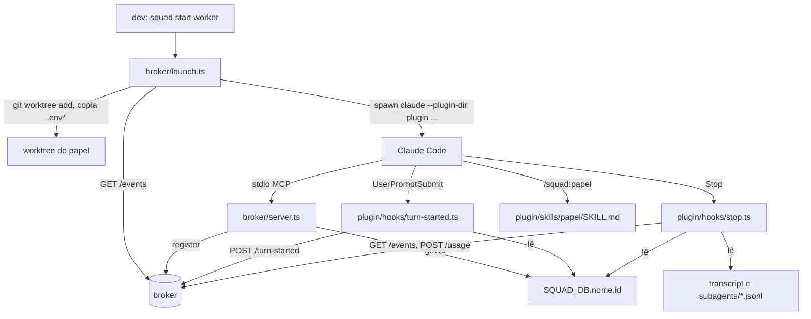

# Papéis Design

**Spec**: `.specs/features/papeis/spec.md`
**Status**: Approved

---

## Architecture Overview

Três peças novas e uma alteração pequena no servidor MCP. O broker não ganha rota nem
evento: `/turn-started`, `/usage`, `/state`, `/permission-request` e as tools por papel
existem desde a Event.

O plugin é carregado no lugar (`--plugin-dir`), então `plugin/` alcança `broker/` por
caminho relativo: o `.mcp.json` aponta para `../broker/server.ts` e os hooks importam
`broker/shared/config.ts` e `broker/shared/derive.ts`. Um plugin instalado por marketplace é
copiado para o cache do Claude Code sem `broker/`, e por isso fica fora do escopo.

## Pesquisa (2026-10-11, Claude Code 2.1.296, Windows 11, Bun 1.4.2)

Seis sessões reais com um plugin descartável em `%TEMP%`, três `-p` e três interativas
dirigidas por um ConPTY. O que foi visto, e não só lido na documentação:

| Pergunta | Visto |
| -------- | ----- |
| O `Stop` de um plugin recebe `transcript_path`? | Sim, com `session_id`, `stop_hook_active`, `last_assistant_message`. No `Stop` o arquivo já tem todas as linhas `assistant` do turno |
| Formato do uso no transcript | `message.usage.{input_tokens, output_tokens, cache_creation_input_tokens, cache_read_input_tokens}` e `message.model` em cada linha `assistant`. Uma mensagem com dois blocos são duas linhas com o mesmo `message.id` e o mesmo `usage`. A soma por id deu os números de `modelUsage` do CLI: 6, 323, 12198, 79889 |
| Subagentes | Arquivos à parte, `<projeto>/<session_id>/subagents/agent-*.jsonl`, linhas com `isSidechain: true` e o mesmo formato de `usage` |
| O transcript existe no `UserPromptSubmit`? | Não no primeiro turno. O hook de início não o lê |
| `--plugin-dir` com canal de desenvolvimento | `--dangerously-load-development-channels plugin:<nome>@inline` funciona: aviso "plugin not installed", o ping chega, `ready` registra, `peer_joined` gravado |
| `source` do canal | `plugin:<plugin>:<servidor>` |
| Nome das tools | `mcp__plugin_<plugin>_<servidor>__<tool>` |
| Nome das skills | `<plugin>:<skill>`; `/<plugin>:<skill>` como prompt posicional roda a skill, em `-p` e em sessão interativa. O ping chega depois, como um segundo turno |
| Ambiente dos hooks | Herdam `SQUAD_*`; recebem `CLAUDE_PLUGIN_ROOT`, `CLAUDE_PLUGIN_DATA`, `CLAUDE_PROJECT_DIR`. A sessão põe `CLAUDE_CODE_CHILD_SESSION=1` nos filhos |
| `acceptEdits` com a tool na lista pelo nome exato | `ready` rodou sem pedido de permissão |
| Modo sem `--permission-mode` | O default da máquina (`auto` na do dev) |
| Diálogos ao subir | Confiança na pasta, na primeira vez em cada diretório, e o aviso do canal de desenvolvimento, em toda subida. O launcher não os responde |

Da documentação, sem ter sido visto: `{"decision":"block","reason":...}` no `Stop` devolve o
agente ao trabalho e `stop_hook_active` vem `true` na parada seguinte; a saída padrão de um
`UserPromptSubmit` com código 0 entra no contexto; o comando de um hook roda no Git Bash no
Windows e em `sh` no Linux; `--allowedTools` é variádico e para na opção seguinte. Ficam em
`real-sessions.md` (RS-04, RS-07).

---

## Code Reuse Analysis

### Existing Components to Leverage

| Component | Location | How to Use |
| --------- | -------- | ---------- |
| `squad(events, now)`, `features`, `presence` | `broker/shared/derive.ts` | O hook de parada chama `squad` sobre o fim de turno hipotético; o launcher usa `features` para a feature aberta e `presence` para o nome do worker |
| `toolsFor(role)` | `broker/tools.ts` | As tools do squad da lista de permitidos e o teste das tools citadas nas skills |
| `dbPath`, `brokerUrl` | `broker/shared/config.ts` | Base do arquivo de credencial e da URL dos hooks e do launcher |
| `loadHumanToken` | `broker/permission.ts` | Padrão de arquivo com modo `0600` |
| `startBroker`, `startSession`, `cleanEnv`, `tempDir`, `post`, `get` | `broker/test/integration/helpers.ts` | Broker e sessão reais nos testes dos hooks e do arquivo de credencial |
| Nomes por papel | `broker/peers.ts` (`namesOf`) | Passa a ser exportado e usado pelo launcher |

### Integration Points

| System | Integration Method |
| ------ | ------------------ |
| Broker | Só rotas que existem: `GET /events`, `POST /turn-started`, `POST /usage` |
| Claude Code | `--plugin-dir`, flag de canal, `--permission-mode`, `--allowedTools`, `--append-system-prompt`, prompt posicional; hooks `UserPromptSubmit` e `Stop` |
| git | `git worktree list --porcelain`, `git rev-parse --verify`, `git worktree add`, `git ls-files` |

---

## Components

### Configuração

- **Location**: `broker/shared/config.ts` (modify)
- **Interfaces**:
  - `idPath(name, env): string` - `dbPath(env) + "." + name + ".id"`
  - `rolesPath(env): string` - `SQUAD_ROLES`, ou `plugin/roles.json` a partir da raiz do squad
  - `pluginDir(): string` - `<raiz do squad>/plugin`
  - `worktreesDir(mainCheckout, env): string` - `SQUAD_WORKTREES`, ou `<pai>/<nome>.squad`
  - `claudeCommand(env): string` - `SQUAD_CLAUDE` ou `claude`
  - `HOOK_TIMEOUT_MS = 2000`

### Arquivo de credencial

- **Location**: `broker/server.ts` (modify)
- Depois do `/register` aceito: `writeFileSync(idPath(NAME), id, { mode: 0o600 })` dentro de um `try`. No `cleanup`, depois do `/unregister`: `rmSync(..., { force: true })` dentro de um `try`. Os quatro textos com `source="squad"` passam a dizer só `kind="ping"`.

### Manifesto do plugin

- **Location**: `plugin/` (`.claude-plugin/plugin.json`, `.mcp.json`, `hooks/hooks.json`)
- `broker/tsconfig.json` ganha `include` com `../plugin` para o `tsc` conferir os hooks.

### Uso

- **Location**: `plugin/hooks/usage.ts`
- **Interfaces**:
  - `usageOf(transcripts: string[]): Record<string, Counts>` - puro: o texto de cada arquivo, na ordem; guarda por `message.id` a última linha contada e soma por modelo
  - `sessionUsage(transcriptPath: unknown): Record<string, Counts>` - lê o principal e `subagents/*.jsonl` em ordem de nome; qualquer falha de leitura do principal dá `{}`

### Sessão do hook

- **Location**: `plugin/hooks/session.ts`
- **Interfaces**:
  - `credential(env): string | null` - nulo sem `SQUAD_ROLE` ou sem arquivo com texto
  - `call(path, body, env): Promise<unknown | null>` - `POST` com prazo de 2000 ms; nulo em erro, status diferente de 200 ou recusa
  - `payload(text): Record<string, unknown>` - o JSON da entrada padrão, ou `{}`

### Hook de início

- **Location**: `plugin/hooks/turn-started.ts`
- Entrada fina: `credential` → `call("/turn-started")`. Nunca escreve na saída padrão.

### Volta ao trabalho

- **Location**: `plugin/hooks/nudge.ts`
- **Interfaces**:
  - `nudge(events: SquadEvent[], name: string, now: number): string | null` - puro: acrescenta um `usage` do nome com `seq` e `ts` depois dos últimos, chama `squad`, e devolve o `reason` de PAP-29 se o agente sai `stalled`

### Hook de fim

- **Location**: `plugin/hooks/stop.ts`
- Ordem: credencial; se `stop_hook_active` não é `true`, `GET /events?after=0` (2000 ms) e `nudge`; com `reason`, imprime o bloqueio e sai; senão `sessionUsage` e um `POST /usage` por modelo em ordem de nome, ou o de `unknown`.

### Leitor do `roles.json`

- **Location**: `broker/roles.ts`, `plugin/roles.json`
- **Interfaces**: `readRoles(path): RoleEntry[]` - lança `Error` com o caminho na mensagem

### Launcher

- **Location**: `broker/launch.ts`
- **Interfaces**:
  - `parseStart(argv): { role, name?, skip } | { error }`
  - `allowed(role, platform): string[]`, `systemPrompt(name, entry): string`, `sessionEnv(env, name, role)`, `sessionArgs(...)` - puros
  - `launch(argv, deps): Promise<number>` - `deps`: `env`, `cwd`, `platform`, `fetch`, `spawn(command, args, { cwd, env }): Promise<number>`, `stderr(line)`. O git roda de verdade (`Bun.spawnSync`), nos testes sobre repositórios temporários
- Ordem de `launch`: argumentos → checkout principal → `roles.json` → log (feature aberta, presença) → nome → worktree e cópia de `.env*` → `spawn`. Toda falha antes do `spawn` é `squad: <causa>` e código 1, e as de validação vêm antes de qualquer escrita.

### CLI

- **Location**: `broker/cli.ts` (modify), `broker/package.json` (`bin`)
- `start` chama `launch` com `Bun.spawn` de `stdio: "inherit"`; `tui` roda `tui.ts` com o mesmo runtime e `stdio: "inherit"`.

### Skills

- **Location**: `plugin/skills/{worker,judge,leader,mother}/SKILL.md`
- Mesmas sete seções, na mesma ordem; a da mother tem a oitava e as duas linhas marcadas para a Gate.

---

## Error Handling Strategy

| Error Scenario | Handling | User Impact |
| -------------- | -------- | ----------- |
| Hook sem papel, sem credencial ou com o broker fora | Sai com 0, sem saída | Nenhum; o turno segue. O agente pode aparecer `working` sem `usage` até o broker voltar |
| Credencial velha de uma sessão morta | O broker responde `unknown_peer`, que o hook trata como falha | Nenhum; o registro seguinte regrava o arquivo |
| Transcript ausente ou com formato novo | `usage` com `unknown` e zeros | Os tokens não sobem; o fim de turno continua marcado |
| `roles.json` inválido, papel ou nome errado, fora de um repositório | `squad: <causa>` e código 1, antes de qualquer escrita | O dev lê a causa no terminal |
| `git worktree add` falha | `squad: <mensagem do git>` e código 1 | Idem |
| `claude` não encontrado | `squad: <comando> ...` e código 1 | Idem |

---

## Risks & Concerns

| Concern | Location (file:line) | Impact | Mitigation |
| ------- | -------------------- | ------ | ---------- |
| O formato do transcript é interno ao Claude Code e muda entre versões | `plugin/hooks/usage.ts` | Uma versão nova pode zerar os tokens sem erro | Linha não reconhecida é ignorada e o fim de turno é marcado do mesmo jeito (PAP-24); RS-06 confere os números numa sessão real; a versão vista fica registrada |
| O transcript é gravado de forma assíncrona | `plugin/hooks/stop.ts` | O `usage` de um turno pode sair sem a última mensagem | O valor é acumulado: o turno seguinte corrige. Nas três sessões vistas o arquivo estava completo no `Stop` |
| `GET /events?after=0` a cada fim de turno lê o log inteiro | `plugin/hooks/stop.ts` | Custo cresce com o log | Localhost e log de uma máquina; prazo de 2000 ms, e sem resposta o hook não bloqueia (PAP-31) |
| A credencial da sessão fica num arquivo que um agente com shell lê | `broker/server.ts` | Um agente pode escrever como outro | Mesmo limite cooperativo do AD-007; arquivo fora de qualquer worktree, modo `0600` |
| `expire` e `cleanStale` rodam em `setInterval` sem `try` | `broker/broker.ts:66`, `:71` | Uma exceção encerra o broker e todo hook passa a falhar em silêncio | Risco anterior à fatia, registrado no Handoff; os hooks nunca travam a sessão por isso |
| O `spawn` real do `claude` e o `bin` não têm teste automático | `broker/cli.ts` | Um erro de fiação só aparece ao usar | RS-01 a RS-04 e RS-14 com sessão real |
| Skills são prosa: o teste de conteúdo não prova que o agente as segue | `plugin/skills/` | Um papel pode ignorar uma regra | Leitura pelo Verifier contra PAP-62 a PAP-72; RS-10 e RS-11 |

---

## Tech Decisions (only non-obvious ones)

| Decision | Choice | Rationale |
| -------- | ------ | --------- |
| Hooks em TypeScript rodados pelo `bun` | `bun "${CLAUDE_PLUGIN_ROOT}/hooks/x.ts"` | Mesmo runtime do broker; o comando vale no Git Bash e no `sh` |
| Hooks importam `broker/shared` | Caminho relativo `../../broker/shared/...` | Um lugar só para a regra de status e para os defaults (L-004) |
| Testes do plugin dentro de `broker/test/` | `bun test` de `broker/` roda tudo | Um comando e um `tsc`; os helpers de broker real já estão lá |
| `spawn` injetado em `launch` | `deps.spawn` | Tudo menos a linha que chama o `claude` de verdade fica testável sem Claude Code |
| Tools do squad na lista pelo nome exato | `ready` + `toolsFor(papel)` com o prefixo | Visto funcionar; não depende de coringa em nome de servidor de plugin |

Decisões de projeto desta fatia: STATE AD-015 a AD-020.
