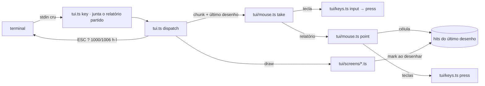

# TUI clicável Design

**Spec**: `.specs/features/tui-clicavel/spec.md`
**Status**: Draft

A spec já diz o que cada clique faz. Este documento diz como a TUI sabe o que está sob o
ponteiro, onde o relatório vira tecla e o que muda no laço. Nada muda no broker.

---

## Abordagens consideradas

A pergunta de arquitetura é uma só: de onde sai "o que está na célula clicada" (CLK-14).

| | Abordagem | Custo | Risco |
|---|---|---|---|
| **A (adotada)** | Cada tela marca, ao desenhar, as células de cada elemento numa camada do `Grid` (`hits`). O laço guarda a camada do último desenho; o clique consulta a célula | Uma chamada `mark` por elemento clicável em cada tela | Baixo: a marca sai das mesmas coordenadas do `put`, e os frames continuam comparando só o texto |
| B | Um módulo de geometria recalcula, a partir da `View`, onde cada elemento está | Nenhuma tela muda | Alto: o layout fica escrito duas vezes (a janela do feed, a paginação da lista de perguntas, a altura do modal) e as duas cópias divergem sem teste que acuse |
| C | Ler o texto do último desenho na célula clicada e reconhecer o elemento | Nenhuma tela muda | Alto: `p pausa` e um corpo de mensagem com `p pausa` são o mesmo texto |

A adotada é a única em que "o elemento vale nas células em que o último desenho o pôs" é
verdade por construção.

---

## Architecture Overview



1. **Leitura.** `keysOf` passa a devolver um relatório como um só item da entrada, como já
   faz com uma seta. `key`, no laço, segura o começo de um relatório partido pelo mesmo
   mecanismo que já segura um `ESC [` partido.
2. **Alvo.** Cada tela marca os elementos clicáveis enquanto desenha. A marca é semântica
   (a tecla de um atalho, o `seq` de uma linha do feed, o `ticket_ref`, o id da pergunta),
   não a posição.
3. **Efeito.** `point` olha a marca da célula e aplica teclas com `press`. Ela nunca monta
   um `Ui` à mão: todo estado que devolve saiu de `press`. É a regra geral do clique
   (AD-021) tornada estrutura.
4. **Laço.** `dispatch` troca `input` por `take`, que percorre os itens do chunk na ordem:
   tecla vai a `input`, relatório vai a `point`, `m` liga e desliga.

---

## Code Reuse Analysis

### Existing Components to Leverage

| Component | Location | How to Use |
| --------- | -------- | ---------- |
| `press` | `broker/tui/keys.ts` | Único caminho de mudança de estado do mouse |
| `input`, `keysOf`, `marks` | `broker/tui/keys.ts` | `take` chama `input` item a item, com `more` verdadeiro quando o chunk tem mais de um item: a regra de colagem (QST-78) passa a contar o relatório como item, o que dá CLK-16 sem regra nova |
| `key`, `pending`, `escapeTimer` | `broker/tui.ts:185` | O relatório partido e o descarte em 40 ms (CLK-07, CLK-08) usam o mesmo temporizador |
| `end` | `broker/tui.ts:122` | Único ponto de saída: `q`, `ctrl+c`, `SIGTERM`, erro e clique em `q` passam por ele |
| `Ui.send`, `post`, `settle` | `broker/tui.ts:148`, AD-014 | O envio pelo clique é o da tecla: `press("\r")` deixa `send`, o laço faz o `POST` |
| `drawKeys`, `chrome`, `stats` | `broker/tui/screens/chrome.ts` | Marcam atalhos, abas, `? N`, selos e custo no mesmo lugar em que os desenham |
| `seals` | `broker/tui/activity.ts:97` | Sem mudança: o selo com tecla é o que termina em `· g` ou `· x` |
| `selected`, `threadTicket`, `waiting` | `broker/tui/screens/questions.ts`, `thread.ts`, `asked.ts` | A pergunta selecionada e o ticket do thread, para contar as teclas até o alvo |
| `MOUSE_ON`, `MOUSE_OFF` | `broker/tui/ansi.ts` | Já existem, da sonda |
| `frameView`, `LOGS`, `DEVIATIONS` | `broker/test/frames/` | As `View` dos testes do mouse são as dos frames; o desvio D4 entra na tabela |
| Teste em pseudo-terminal | `broker/test/integration/mouse-probe.test.ts`, `cli.test.ts:286` | Modelo do teste que clica na TUI pelo processo real |

### Integration Points

| System | Integration Method |
| ------ | ------------------ |
| `tui.ts` `start` | `Settings.mouse`; `MOUSE_ON` depois de `ENTER` e `MOUSE_OFF` antes de `LEAVE`; `dispatch` chama `take`; `draw` guarda `drawn` |
| `tui.ts` `config` | Lê `SQUAD_TUI_MOUSE` por `mouseOn` de `tui/config.ts`; valor inválido lança antes do laço, como `SQUAD_TUI_GLYPHS` |
| `tui/keys.ts` | `KEY` reconhece os relatórios; `input` os pula; `notice` é exportada |
| `tui/grid.ts` | Camada `hits` ao lado de `rows`; `clear` apaga as marcas da região |
| Broker, servidor MCP, plugin | Sem mudança |

---

## Components

### Camada de alvos do `Grid`

- **Purpose**: guardar, por célula, o que um clique ou a roda atinge ali.
- **Location**: `broker/tui/grid.ts`
- **Interfaces**:
  - `Hit`: ver "Data Models".
  - `hits: (Hit | null)[][]`: 40 × 120, tudo `null` num grid novo.
  - `mark(x, y, w, h, hit)`: põe `hit` nas células do retângulo que caem dentro do grid. Substitui o que havia: quem marca diz tudo o que a célula é.
  - `clear(x, y, w, h)`: passa a apagar também as marcas da região.
- **Dependencies**: nenhuma.
- **Reuses**: a forma de `bg` e `clear`. `Cell` não ganha campo: `paint`, `text` e os testes que comparam células não veem a camada.

### Marcas das telas

- **Purpose**: dizer, no lugar em que cada elemento é desenhado, o que ele é.
- **Location**: `broker/tui/screens/chrome.ts`, `main.ts`, `thread.ts`, `questions.ts`, `answer.ts`
- **Interfaces** (nenhuma função muda de assinatura, a não ser `drawKeys`, que ganha `modal = false`):

| Onde | Células | Marca | Requisito |
| ---- | ------- | ----- | --------- |
| `chrome` linha 1 | Cada aba, com os espaços dela e o contador da `4 perguntas` | `key`: `1`, `2`, `3`, `4`, `?` | CLK-18 |
| `chrome` linha 0 | O contador ` ? N `, com os dois espaços | `key: "4"` | CLK-23 |
| `chrome` linha 1 | O selo cujo texto termina em `· g` ou `· x` | `key: "g"` ou `"x"` | CLK-36 a CLK-38 |
| `stats` linha 38 | De `│` até o fim de ` est.` | `key: "t"` | CLK-39 |
| `drawKeys` | Atalho simples: as células da tecla e as da descrição. Atalho de duas teclas: só a célula de cada caractere `j`, `k`, `[`, `]`, `↑`, `↓`. Atalho de faixa e rótulo desconhecido: nada | `key` | CLK-33 a CLK-35, CLK-45 |
| `main` | As três caixas, borda incluída | `panel: 0`, `1` ou `2`; a do feed também `wheel: "feed"` | CLK-19, CLK-28 |
| `main` feed | As 56 colunas de dentro de cada linha de evento | `panel: 1`, `wheel: "feed"`, `row: seq` | CLK-20, CLK-21 |
| `main` tickets | As 26 colunas de dentro de cada linha de um ticket (as duas, na forma de duas linhas) | `panel: 0`, `ticket: ref` | CLK-22 |
| `thread` | A caixa da esquerda, borda incluída | `wheel: "thread"` | CLK-29 |
| `questions` lista | A caixa, borda incluída | `wheel: "list"` | CLK-30 |
| `questions` lista | As 58 colunas de dentro de cada linha desenhada de uma pergunta: cabeça, texto, opções ou default, rota | `wheel: "list"`, `question: id` | CLK-24, CLK-25 |
| `questions` histórico | A caixa, borda incluída | `history: true`, `wheel: "history"` | CLK-26, CLK-31 |
| `questions` detalhe | Na linha `enter responder   b próxima bloqueante`, quando ela cabe: tecla e descrição de cada um | `key: "\r"`, `key: "b"` | CLK-33 |
| `answer` | Todas as células das linhas 0 a 38 fora da caixa, a margem vazia em volta dela incluída | `modal: true`, `key: "\x1b"` | CLK-40, CLK-43 |
| `answer` | A caixa, borda incluída | `modal: true` | CLK-44 |
| `answer` | As 80 colunas de dentro de cada linha de opção e de `outra resposta…` | `modal: true`, `option: i` | CLK-41, CLK-42 |
| `answer` linha 39 | Os atalhos do modo, por `drawKeys(..., true)` | `modal: true`, `key` | CLK-45 |

- **Dependencies**: a camada de alvos.
- **Reuses**: as coordenadas que cada função já calcula para o `put`. `topology`, `help` e `detail` não marcam nada além do que `chrome` marca. `down` e `small` marcam o que `main` e `drawKeys` marcam, e o laço não usa essas marcas (ver "Laço").

### Leitura do relatório

- **Purpose**: fazer de um relatório um item só da entrada, que nunca é tecla nem texto.
- **Location**: `broker/tui/keys.ts` (o reconhecimento) e `broker/tui/mouse.ts` (o significado)
- **Interfaces**:
  - `KEY` ganha, antes da alternativa de CSI: `ESC [ <` com dígitos e `;` e uma letra opcional no fim; e `ESC [ M` com até três caracteres.
  - `isReport(item): boolean` em `keys.ts`: o item começa por `ESC [ <` ou por `ESC [ M`.
  - `input` pula o item que `isReport` aceita. Ele continua contando para "o chunk tem mais de um item".
  - `parse(item): Report | null` em `mouse.ts`: os três inteiros e o final; `null` para o que não é `ESC [ < b ; x ; y` seguido de `M` ou `m`.
- **Dependencies**: nenhuma.
- **Reuses**: a tokenização que já existe; `marks`, da tela pequena, passa a ignorar relatórios sem mudar.

### Redutor do mouse

- **Purpose**: o que um relatório faz ao estado da tela, e o que um chunk inteiro faz.
- **Location**: `broker/tui/mouse.ts` (novo)
- **Interfaces**:
  - `point(at: Entry, item: string, view: View, drawn: Drawn | null): Entry | null`: o estado depois de um relatório; `null` quando o clique sai (atalho `q`).
  - `take(at: Entry, chunk: string, view: View, more: boolean, drawn: Drawn | null): Entry | null`: o estado depois dos itens do chunk, na ordem (CLK-15).
- **Dependencies**: `press`, `input`, `keysOf`, `isReport`, `notice` de `keys.ts`; `selected` de `screens/questions.ts`; `threadTicket` de `screens/thread.ts`; `waiting` de `asked.ts`.
- **Reuses**: `press` para todo efeito.

`point`, nesta ordem:

1. `parse` devolve `null`: nada (CLK-09, CLK-10).
2. Mouse desligado: nada (CLK-51).
3. Não é clique nem roda: nada (CLK-06). O botão é `b` sem os bits 4, 8 e 16; com o bit 32 ele não é 0, 64 nem 65.
4. É clique: `quick` é verdadeiro se o clique anterior foi há menos de 500 ms; `clickedAt` passa a ser o relógio da `View`.
5. `drawn` é `null`, ou a tela do desenho não é a do estado: nada (CLK-12, CLK-13, e o relatório que chega depois de uma tecla do mesmo chunk ter trocado de tela).
6. Célula fora de 0 a 119 ou de 0 a 39: nada (CLK-11).
7. A marca da célula tem `modal` e o estado não tem modal, ou o contrário: nada (CLK-40).
8. Com modal: roda, nada (CLK-48); `quick`, nada (CLK-46); `option`, as teclas `j` ou `k` da marca atual até a clicada, e `enter` se ela é a de `outra resposta…`; `key`, a tecla; senão nada.
9. Sem modal, roda: pela marca `wheel` (tabela abaixo); sem ela, nada (CLK-32).
10. Sem modal, clique: `key`, a tecla. Senão, se há `panel`, as teclas `tab` até o foco ser ele; depois `row`, `ticket`, `question` ou `history` (tabela abaixo).

| Marca | Teclas | Requisito |
| ----- | ------ | --------- |
| `key` | A tecla | CLK-18, CLK-23, CLK-33, CLK-34, CLK-36, CLK-37, CLK-39, CLK-45 |
| `panel` | `tab` × ((painel − foco + 3) mod 3) | CLK-19 |
| `row`, não selecionada | `k` ou `j` até ela; sem seleção, o primeiro `k` seleciona a última | CLK-20 |
| `row`, selecionada | `enter` | CLK-21 |
| `ticket` | `3`, depois `[` ou `]` até o ticket | CLK-22 |
| `question`, selecionada e foco na lista | `enter` | CLK-24 |
| `question`, outro caso | `h` se o foco está no histórico; `k` ou `j` até ela | CLK-25 |
| `history` | `h` se o foco está na lista | CLK-26 |
| `wheel: "feed"` | `tab` até o foco 1; `k` × 3 ou `j` × 3 | CLK-28 |
| `wheel: "thread"` | `k` ou `j` | CLK-29 |
| `wheel: "list"` | `h` se o foco está no histórico; `k` ou `j` | CLK-30 |
| `wheel: "history"` | `h` se o foco está na lista; `k` ou `j` | CLK-31 |
| `option` | `k` ou `j` até ela; `enter` se é `outra resposta…` | CLK-41, CLK-42 |

`take`, por item do chunk: relatório vai a `point`; `m` sem modal aberto inverte `on` e põe o
aviso de 4 s (CLK-50); o resto vai a `input(ui, item, view, more || o chunk tem mais de um item)`.

### Configuração

- **Purpose**: `SQUAD_TUI_MOUSE`.
- **Location**: `broker/tui/config.ts`
- **Interfaces**: `mouseOn(env): boolean`: ausente, vazia ou `1`, verdadeiro; `0`, falso; outro valor lança `SQUAD_TUI_MOUSE: "<valor>" is not 0 or 1`.
- **Reuses**: a forma de `readIntervalMs` e a mensagem de `parseGlyphs`.

### Laço

- **Purpose**: pedir e desfazer os relatórios, guardar o último desenho e entregar o chunk a `take`.
- **Location**: `broker/tui.ts`
- **Interfaces**: `Settings` ganha `mouse: boolean`. `Io` não muda.
- **O que muda em `start`**:
  - `io.write(ENTER + (settings.mouse ? MOUSE_ON : ""))` (CLK-01, CLK-52); `end` escreve `MOUSE_OFF + LEAVE` sempre (CLK-02).
  - `pointer: Pointer` ao lado de `ui`, começando em `{ on: settings.mouse, clickedAt: null }`.
  - `draw` guarda `drawn`: `null` quando desenhou a tela pequena ou a congelada; senão as marcas do grid e `ui.screen`.
  - `dispatch`: `take({ ui, pointer }, chunk, view(), more, drawn)`. Se `on` mudou, escreve `MOUSE_ON` ou `MOUSE_OFF`. O resto segue igual: `post` quando `send` é novo, e `draw`.
  - `key`: a expressão que segura o fim do chunk passa a aceitar `ESC [ <` com dígitos e `;`, e `ESC [ M` com até dois caracteres. O que sobra depois de 40 ms vai a `dispatch` como hoje, e `keysOf` o lê como um relatório sem fim, que `point` descarta.
- **Reuses**: `end`, `key`, `post`, `draw`.

### Tela de ajuda

- **Purpose**: a linha de CLK-55.
- **Location**: `broker/tui/screens/help.ts`, `broker/test/frames/deviations.ts`
- **Interfaces**: `SHORTCUTS` troca a linha vazia depois de `? · q` (linha 10 da tela) por `key("m", "mouse liga / desliga · clique = tecla")`. `Deviation.class` ganha `"D4"`; o frame 11 ganha um desvio D4 na linha 10.
- **Reuses**: `key` de `help.ts`, `d` de `deviations.ts`.

### Sonda

- **Purpose**: CLK-17. Já entregue em `313d433`.
- **Location**: `broker/tui/mouse-probe.ts`

---

## Data Models

```typescript
// tui/grid.ts: what a cell is to the mouse
export interface Hit {
  // drawn by the modal of answer
  modal?: true;
  // the key a click here presses
  key?: string;
  // the panel of the main screen the cell is in
  panel?: 0 | 1 | 2;
  // the seq of the line of the feed
  row?: number;
  ticket?: string;
  // the id of a question of the list
  question?: number;
  history?: true;
  // what the wheel rolls here
  wheel?: "feed" | "thread" | "list" | "history";
  // the line of the choice mode of the modal; the one after the options is `outra resposta…`
  option?: number;
}

// tui/mouse.ts
export interface Report { button: number; x: number; y: number; pressed: boolean }
// The mouse of the TUI: whether the terminal was asked for reports, and when the last click came
export interface Pointer { on: boolean; clickedAt: number | null }
// The last drawing written to the terminal: its marks and the screen it was drawn from
export interface Drawn { hits: (Hit | null)[][]; screen: Ui["screen"] }
export interface Entry { ui: Ui; pointer: Pointer }
```

`Ui` não muda. `test/frames/view.ts` e `tui-keys.test.ts` escrevem o `Ui` campo a campo, e a
spec pede que os testes de teclas e de frames passem sem alteração; por isso o que é do
mouse fica em `Pointer`, fora do estado que as telas desenham.

---

## Error Handling Strategy

| Error Scenario | Handling | User Impact |
| -------------- | -------- | ----------- |
| Relatório partido entre leituras | `key` segura o começo; `keysOf` o lê inteiro quando o resto chega | Nenhum |
| Relatório que não termina em 40 ms | O que sobrou vira um item sem final, que `parse` recusa | Nenhum: nem tecla, nem texto |
| `ESC [ <` com letra antes dos três inteiros | Um item, que `parse` recusa | Nenhum |
| Formato antigo (`ESC [ M` e três caracteres) | Um item, que `parse` recusa | O clique não faz nada; o teclado segue |
| Célula fora da grade, `x` ou `y` 0, inteiro grande demais | `Number` e a comparação com 0 a 119 e 0 a 39 | Nenhum |
| Clique sobre desenho de outra tela ou de outro modo (tecla e relatório no mesmo chunk) | A guarda de tela e a de `modal` | O clique não faz nada |
| Terminal menor que 120×40, broker sem responder | `drawn` é `null`; na tela pequena `dispatch` nem chama `take` | O mouse não faz nada; o teclado como hoje |
| `SQUAD_TUI_MOUSE` inválida | `config` lança; o processo sai com 1 antes da tela alternativa | Uma linha com a variável e o valor |
| Terminal que não manda relatório | Nada a tratar | A TUI de antes |
| Erro dentro de `take` | O `try` de `dispatch` chama `fail`, que passa por `end` | Terminal restaurado, erro no stderr, código 1 |

---

## Leituras da spec

O que a spec deixa em aberto e este design fecha. Nenhuma muda uma linha marcada `y`.

| Ponto | Leitura | Por quê |
| ----- | ------- | ------- |
| CLK-19 com CLK-20 a CLK-22 | O clique numa linha do feed ou num ticket dá o foco ao painel e depois faz o resto | CLK-19 vale para toda célula do painel, e CLK-27 fala em "no máximo, o foco de CLK-19" (L-048) |
| CLK-33, o espaço entre a tecla e a descrição | Não faz nada | A regra cita "célula da tecla ou da descrição" |
| CLK-41, a borda na linha de uma opção | Não faz nada | CLK-44 dá a borda como célula sem efeito |
| CLK-46, "clique anterior" | Todo clique lido com o mouse ligado, também o que não fez nada | Num clique triplo, o terceiro vem menos de 500 ms depois do segundo e também é ignorado |
| CLK-46 fora do modal | A regra só olha o modal aberto na hora do clique; o clique que abre o modal é normal | A história inteira vale "com o modal aberto" |
| CLK-09, sequência que chega a outro caractere que não letra | Os caracteres de `ESC [ <` até ali são descartados; o caractere seguinte é tecla | A regra só fala em letra |
| CLK-10, formato antigo partido ou incompleto | Descartado como o inteiro | Mesmo motivo de CLK-08 |
| CLK-14 com dois relatórios no mesmo chunk | Os dois são comparados com o mesmo desenho, o último escrito; o segundo só vale se a tela e o modo não mudaram | É o que o dev viu ao clicar; a roda manda vários relatórios por leitura e todos valem |
| CLK-50 com o broker sem responder | `m` liga e desliga | É tecla, e o teclado segue como hoje na tela congelada |
| CLK-55, qual linha | A linha 10 da tela, vazia no frame 11, no fim do grupo "global" | A linha 24 é afirmada vazia por um teste de QST-88; as de 25 a 33 são dos modais da Gate |

---

## Risks & Concerns

| Concern | Location (file:line) | Impact | Mitigation |
| ------- | -------------------- | ------ | ---------- |
| O Windows Terminal pode não mandar relatórios ao pedido da TUI | `broker/tui/mouse-probe.ts` | A fatia não tem como funcionar | RT-01, rodada pelo dev antes de qualquer outra tarefa. Metade já vista: num pseudo-terminal do Windows os relatórios chegam inteiros ao `stdin` do Bun 1.4.2 (`test/integration/mouse-probe.test.ts`) |
| `KEY` lê `ESC [ <` como `esc`, `[`, `<` e dígitos | `broker/tui/keys.ts:37` | Um relatório troca de tela e entra no texto de uma resposta | Primeira tarefa de código: o reconhecimento, com teste de que nenhum caractere vira tecla, também com `input` sozinho |
| A expressão de `key` não segura `ESC [ <` | `broker/tui.ts:191` | Relatório partido vira teclas | Mesma tarefa do laço que liga `take`; teste com o relatório cortado em cada posição |
| Formato antigo com coluna acima de 95 manda bytes que não são UTF-8 | `broker/tui.ts:250` (`chunk.toString()`) | Dois bytes podem virar um caractere, e o descarte leva um caractere a mais | Aceito e registrado: só acontece num terminal que atende o modo 1000 e ignora o 1006. A TUI pede os dois |
| `expect(t.out).toBe(ENTER)` e `Settings` escrito campo a campo no teste do laço | `broker/test/unit/tui-loop.test.ts:86`, `:133` | `Settings.mouse` obrigatório quebra a compilação do teste | O ajudante `launch` ganha `mouse: false`; os testes do mouse no laço ficam em arquivo próprio |
| O teste TUI-49 afirma a lista inteira de desvios do frame 11, e o TUI-43 as três classes | `broker/test/unit/tui-frames.test.ts:49`, `:130` | O desvio D4 quebra os dois | São a exceção que a spec já prevê ("fora a linha de CLK-55"): a tarefa da ajuda muda as duas afirmações e nenhuma outra |
| `tui/demo.ts` não tem teste | `broker/tui/demo.ts` | Nenhum: ele sobe `tui.ts` como processo e herda o mouse | Nada a fazer |
| Processo morto sem aviso deixa o terminal mandando relatórios | — | O shell recebe `ESC [ <…` a cada clique | Fora do alcance (spec, Assumptions); `real-terminal.md` registra o `reset` |

---

## Tech Decisions (only non-obvious ones)

| Decision | Choice | Rationale |
| -------- | ------ | --------- |
| Onde fica o alvo do clique | Camada `hits` do `Grid`, marcada pelas telas | Ver "Abordagens consideradas" |
| Como o mouse muda o estado | Só por `press`, tecla a tecla | A regra geral do clique vira estrutura; o teste de cada requisito compara com `press` |
| Onde fica o estado do mouse | `Pointer`, fora de `Ui` | `Ui` é escrito campo a campo em testes que a spec manda não alterar |
| Com que desenho o clique é comparado quando o chunk tem mais de um item | Com o último escrito, mais a guarda de tela e de modo | Redesenhar entre dois itens compararia o clique com uma tela que o dev não viu; sem a guarda, `enter` e um clique no mesmo chunk enviariam a primeira opção |
| Quem trata `m` | `take`, não `press` | Ligar e desligar muda `Pointer`, que `press` não conhece; no modal `m` segue para `input` e é texto |
| Marca substitui ou soma | Substitui | Quem marca diz tudo o que a célula é; o modal apaga o que a aba marcou só por marcar por cima |

> **Decisão de projeto:** a regra geral do clique entra em `.specs/STATE.md` como AD-021,
> na tarefa que cria `tui/mouse.ts`.
